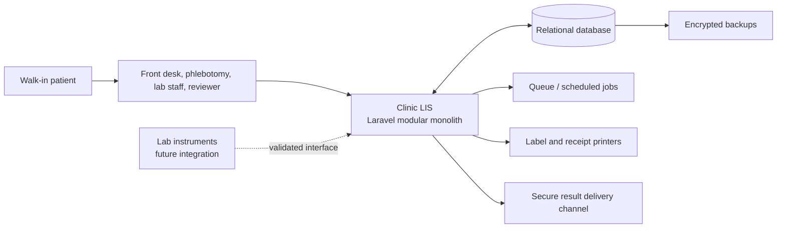

# Walk-In Laboratory Information System Architecture

## 1. Purpose

This document describes a target architecture for a clinic laboratory information system (LIS) that serves walk-in patients. It covers registration through specimen collection, testing, result review, payment, and result delivery.

The repository is a Laravel 11 application with existing diagnostic, test, package, result, and user models. Those are useful starting points, but this document describes a target design; it does not imply that every workflow or control below is already implemented. In particular, patient visits, orders, specimens, payments, result authorization, and audit history should be represented explicitly rather than inferred from one wide patient or result record.

## 2. Goals and design principles

- Keep walk-in registration and checkout fast while identifying patients and specimens reliably.
- Make every order, specimen, result, and release traceable to a patient visit and responsible staff member.
- Prevent results from being released before required review and authorization.
- Keep clinical, financial, and operational workflows understandable to clinic staff.
- Start with a maintainable modular monolith; add services or instrument interfaces only when operational needs justify them.
- Protect patient data using least privilege, secure delivery, auditability, backups, and applicable local privacy and laboratory regulations.

## 3. Scope

### In scope

- Patient search and registration, duplicate review, and walk-in visit creation.
- Test catalog, test orders, packages, preparation instructions, and pricing.
- Queue and order status tracking.
- Specimen labels, collection, receipt, rejection, and recollection.
- Manual result entry and a path for instrument-result integration.
- Result validation, review, authorization, amendments, and critical-result follow-up.
- Payment records and receipts.
- Secure result delivery and delivery history.
- Staff roles, audit trail, basic inventory/QC records, operational dashboards, and downtime procedures.

### Not in the initial scope

- A patient-facing mobile application.
- Automated clinical diagnosis or treatment recommendations.
- Multi-site enterprise operation, advanced billing/insurance adjudication, or a full analyzer integration engine.

These can be considered later without changing the core patient-visit and order model.

## 4. System context and component view

### Logical modules

1. **Identity and access:** staff accounts, roles, permissions, session controls.
2. **Patient registry:** patient demographics, contact details, identity matching, and merge/review workflow for suspected duplicates.
3. **Visit and queue:** walk-in encounter number, timestamps, current queue stage, and service status.
4. **Catalog and pricing:** individually saleable examinations and packages/bundles, package components, specimen requirements, preparation instructions, reference-range configuration, and price list.
5. **Orders and billing:** individual-exam and package selections, resolved examination work items, ordering clinician when applicable, charge items, payment and receipt records.
6. **Specimen management:** accession number, barcode, specimen type, collection and receipt events, rejection reason, and recollection linkage.
7. **Laboratory workflow:** worklists, manual entry or instrument results, QC checks, validation, review, and authorization.
8. **Result communication:** release, report generation, patient identity verification, delivery tracking, and critical-result escalation.
9. **Operations and quality:** workload and turnaround reporting, reagent lot/expiry tracking, QC records, audit events, and downtime reconciliation.

Modules should be separated by Laravel namespaces and service boundaries while sharing one application and relational database initially. Controllers should handle HTTP concerns; policies authorize access; application services coordinate multi-record workflows and transactions; Eloquent models represent persisted entities. Do not put workflow transitions or result-release rules only in controllers or view code.

## 5. Primary walk-in workflow

1. **Check in:** search for an existing patient using approved identifiers. Review possible matches before creating a new record. Create a visit and display/print its visit number.
2. **Order:** select one or more standalone examinations, packages, or both from the active catalog. Show preparation requirements for the examinations included and verify any required acknowledgement. Record the selected catalog items and who placed the order and when.
3. **Payment:** record charge items, payment method, amount, receipt number, and cashier. Keep payment status distinct from laboratory status so clinic policy can define whether collection proceeds before payment is complete.
4. **Collect:** create one or more specimen records, print barcode labels, and record collector, time, type, and collection site if relevant. Confirm identifiers at collection.
5. **Receive and process:** log specimen receipt and route tests to worklists. Record rejection or recollection with reason and preserve the original event.
6. **Enter and review results:** enter or import results with units and configured reference ranges. Apply validation flags; require appropriate review and authorization before release.
7. **Release and follow up:** create a report snapshot, record release and delivery events, verify the patient's identity before handing over results, and document critical-result contact attempts and outcomes.
8. **Close visit:** show outstanding tests, balances, unreleased results, and follow-up tasks. A visit can be operationally complete while retaining a follow-up task when appropriate.

Queue views should be derived from explicit workflow status and timestamps, not from assumptions about which screen a record appeared on. Long-running work should be retriable and should not create duplicate orders, payments, or releases.

## 6. Core data model

Use stable internal identifiers (UUID or database-generated IDs) and human-readable, unique visit/accession numbers for operational use. Barcodes should encode an opaque specimen identifier, not patient demographics.

| Entity | Purpose and key relationships |
|---|---|
| `patients` | Demographics and contact details; one patient can have many visits. Store only information needed for care and operations. |
| `visits` | One walk-in encounter with unique visit number, check-in time, staff, and lifecycle status. Belongs to a patient. |
| `examinations` | Individually saleable laboratory examination definition, specimen requirements, preparation text, active state, and configurable result metadata. |
| `packages` / `package_items` | Saleable bundle and its component examinations, with effective dates/versioning. Package composition is copied or otherwise snapshotted onto the order when purchased so later catalog edits do not change historical orders. |
| `orders` | Order placed during a visit; ordering source, staff, timestamps, and status. |
| `order_items` | Selected billable line: either a standalone examination or a package, with quantity and snapshots of description and price. Preserve the patient's selection and the charged amount independently of the laboratory work generated from it. |
| `ordered_examinations` | Resolved examination work items. A standalone order line creates its examination work item; a package order line creates one work item per package component. Each work item links to its source order line and, for package purchases, the package and component snapshot. Specimens and results attach to these examination work items. |
| `payments` / `payment_items` | Amounts, method, receipt/reference, cashier, and links to billable order items; supports partial payment or reversal through explicit transactions if needed. |
| `specimens` | Accession/barcode, order or order-item relationship, specimen type, collection/receipt data, and current status. |
| `specimen_events` | Append-only collection, receipt, rejection, relabel/recollection, and routing history with actor and time. |
| `results` | One test result per ordered test, with value, unit, reference-range snapshot, flags, status, and entry source. Avoid a single table with one column for every possible analyte. |
| `result_reviews` | Reviewer, authorization decision, time, and reason; preserves review history. |
| `result_revisions` | Prior and replacement values, reason, actor, and time for amended results. Never silently overwrite a released result. |
| `delivery_events` | Release channel, recipient identity-check method, delivery time, actor, and outcome. |
| `critical_result_events` | Escalation status, contact attempts, recipient, time, and outcome. |
| `users`, `roles`, `permissions` | Staff identity and access policy; permission checks apply to actions and patient data. |
| `audit_events` | Actor, action, entity reference, timestamp, and appropriate before/after details for sensitive changes. |
| `reagent_lots`, `quality_control_runs` | Lot/expiry inventory and QC results, with links to test/instrument/work period where applicable. |

Use foreign keys, uniqueness constraints, and database transactions for operations that change multiple related records. Add indexes for patient search identifiers, visit number, accession/barcode, status, and timestamps used by worklists. Do not use a patient's name, contact number, or government identifier as a primary key.

### Individual examinations and packages

An individual examination is independently selectable and priced. A package is also selectable and priced, but represents a bundle of multiple examination components (for example, an executive examination); it is not itself a result or specimen. On order placement, preserve the package as the billable selection and create the corresponding examination work items from its configured components. Each component is then collected, processed, reviewed, and reported according to its own requirements.

Keep the two concepts distinct:

- The **bill** reflects the selected standalone examinations and/or package prices, including any approved discount or adjustment.
- The **laboratory worklist and results** reflect the resolved examination components, not a single package-level result.
- Each generated examination work item retains provenance to the standalone selection or package component that generated it. Snapshot the catalog description, component list/version, and applicable prices at order time.
- If an examination is selected individually and is also included in a selected package, flag the overlap for staff confirmation. Do not silently drop a component or charge twice; apply the clinic's configured policy and retain the decision in the order/audit history.
- Changing a package's components or price affects future orders only. An already placed order remains reproducible from its snapshots.

## 7. Workflow states and invariants

Keep separate but related state machines for visits, orders, specimens, results, and payments. Example specimen states: `awaiting_collection`, `collected`, `received`, `in_process`, `completed`, `rejected`, `recollection_required`. Example result states: `draft`, `entered`, `needs_review`, `authorized`, `released`, `amended`.

Enforce these invariants in application services and, where practical, database constraints:

- Every order belongs to a visit and every visit belongs to a patient.
- Every billable order item is explicitly a standalone examination or a package; every resulting examination work item traces back to that selection and its catalog snapshot.
- Package pricing is charged at the selected package line; component examinations are not separately charged unless the clinic explicitly configures and records that pricing policy.
- Every specimen is traceable to an order; a recollection links to the rejected or replaced specimen.
- Every result identifies the ordered test, entry source, actor, and time.
- Only authorized roles can approve results; only eligible results can be released.
- Critical values create a follow-up task/event and cannot be treated as communicated until contact is documented.
- Released results are immutable records; corrections create an amendment and a new delivery event.
- Payment reversals and refunds are new auditable transactions, not deletion or silent edits.
- Repeated requests are safe to retry through idempotency keys or unique operation references where duplicate submission is possible.

Exact status names, reference intervals, critical thresholds, retention periods, and authorization rules must be approved by the clinic's laboratory lead and configured according to local requirements.

## 8. Application interfaces and integrations

- **Staff web UI:** responsive role-specific screens for registration, cashier, collection, bench work, review, and administration. Keep common walk-in actions keyboard-friendly and minimize duplicate entry.
- **Internal HTTP endpoints:** validate input, authorize using policies, and return explicit validation/conflict errors. Use CSRF protection for browser sessions and rate limits on sensitive entry points.
- **Printing:** render labels and receipts from server-side templates with unique visit/accession identifiers and a human-readable fallback.
- **Instrument interface (later phase):** isolate analyzer communication behind an adapter. Validate instrument identity, message structure, patient/specimen mapping, units, and duplicate messages; quarantine unmatched or invalid messages for staff resolution. Never release imported values without the configured review process.
- **Notifications:** use queued jobs for non-blocking delivery and reminders. Persist delivery attempts and surface failure to staff rather than silently marking a message as delivered.
- **Exports and reports:** restrict access, record exports, and avoid unnecessary patient identifiers in operational summaries.

## 9. Security, privacy, and audit

- Require authenticated staff accounts and role-based, least-privilege permissions. Apply authorization checks server-side for every protected action.
- Use HTTPS in deployment, secure session settings, CSRF protection, input validation, and safe output encoding.
- Collect the minimum patient data necessary; protect backups and secrets; define retention, deletion, and access rules with the clinic's compliance owner.
- Record access and changes to patient records, orders, results, payments, and delivery. Keep audit events append-only to normal application roles and avoid logging credentials or unnecessary sensitive values.
- Require stronger controls for sensitive result release and administrative changes; consider re-authentication for high-impact actions.
- Define account provisioning/deprovisioning, password recovery, backup restoration, incident handling, and periodic access review.
- Confirm applicable local privacy, health-record, laboratory accreditation, and record-retention obligations before production deployment. This document is not a compliance certification.

## 10. Reliability and operations

- Use database transactions around visit/order creation, specimen registration, authorization/release, and payment posting.
- Use Laravel queues for notifications, report rendering, and future interface processing; make jobs retry-safe, bounded, and observable.
- Provide clear queue failure/retry visibility. Failed instrument messages or patient notifications must remain actionable.
- Back up the database and uploaded artifacts on a defined schedule, encrypt backups, monitor backup success, and test restoration.
- Define a downtime process using pre-numbered visit/accession forms, specimen identity checks, and later reconciliation with duplicate detection.
- Monitor application errors, queue depth, database capacity, failed logins, and backup health without placing patient data in general-purpose logs.

## 11. Non-functional targets

Set measurable service targets with clinic stakeholders before deployment. Initial design goals:

- Registration and worklist screens should remain responsive during expected clinic peak volume.
- A patient, visit, order, specimen, and result should be searchable by their operational identifiers.
- No silent data loss on retry, queue failure, or instrument-message failure.
- All result releases and amendments should be auditable and attributable.
- Routine backups should meet an agreed recovery point and recovery time objective.
- Operational dashboards should show collection-to-result and result-to-release turnaround time, with clear definitions for each metric.

Capacity values and recovery objectives are deployment decisions; avoid selecting them without expected volume and clinic operating-hour information.

## 12. Suggested implementation sequence

1. **Foundation:** normalize patients, visits, orders, order items, specimens, and result entities; establish staff roles, migrations, audit events, and core policies.
2. **Walk-in operations:** registration/search, visit queue, catalog, packages, payment/receipt recording, barcode printing, collection, and specimen status boards.
3. **Results lifecycle:** structured result entry, configurable reference metadata, review/authorization, release report, secure handover tracking, amendments, and critical-result follow-up.
4. **Quality and reporting:** QC and reagent lot records, operational dashboards, backup/restore drills, and downtime reconciliation.
5. **Integrations:** add instrument interfaces and external delivery channels only after core identity matching, audit, retry, and exception workflows are proven.

At each stage, migrate existing records with explicit mapping, preserve original identifiers where useful, test reconciliation totals, and retain a rollback and audit plan. Do not expose legacy result entry paths as a parallel release mechanism once the authorized workflow is in use.
